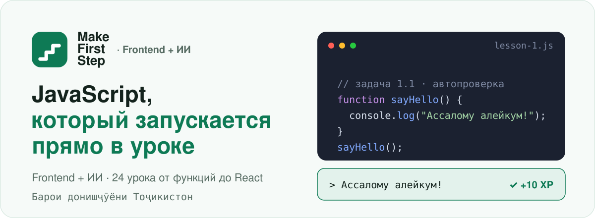
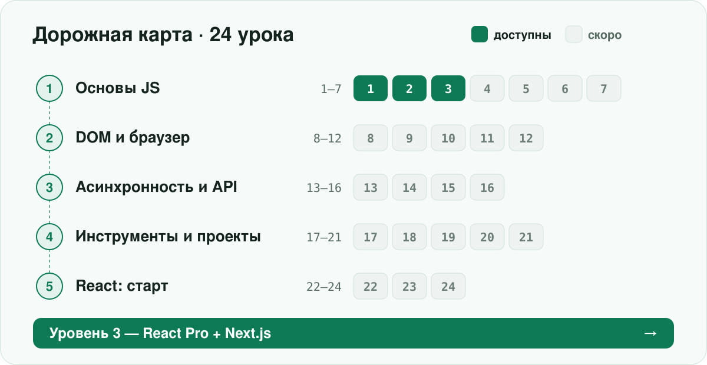
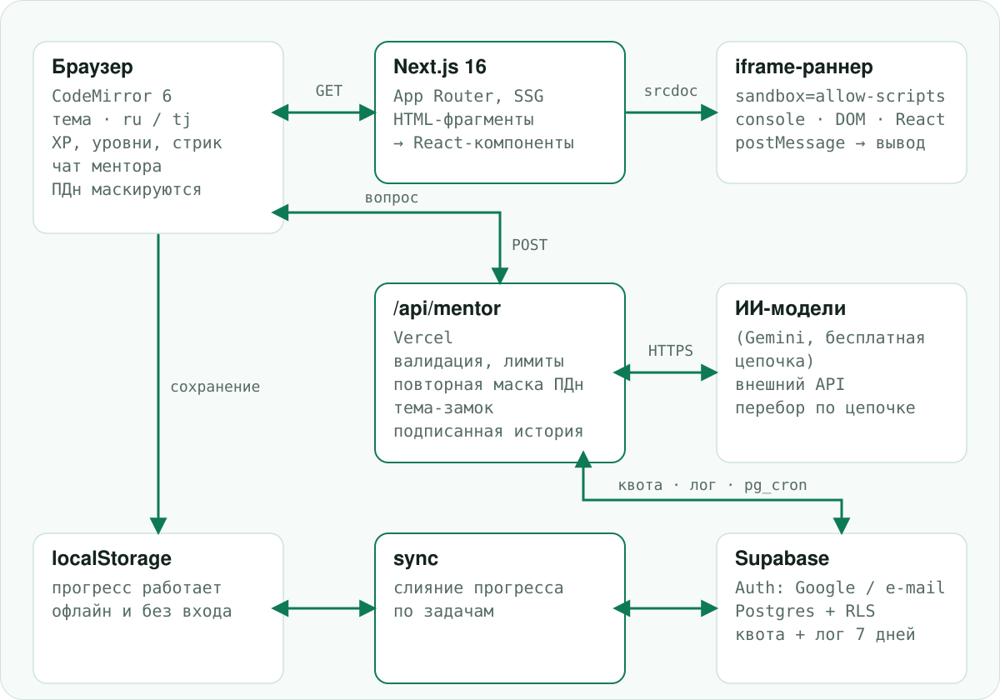

<p align="center">
  <picture>
    <source media="(prefers-color-scheme: dark)" srcset="docs/readme/hero-dark.svg">
    
  </picture>
</p>

<p align="center"><i>Курси интерактивии JavaScript барои донишҷӯёни Тоҷикистон.</i></p>

## Что это

**Ilmhona · Frontend + ИИ** — интерактивный курс JavaScript для студентов Таджикистана на русском и таджикском (`ru` / `tg`). Это 24-урочная дорожная карта от функций до React. Сейчас доступны уроки 1–3: функции, массивы, объекты.

- **Живой код в уроке.** Редактор на CodeMirror 6: код можно менять и запускать прямо на странице.
- **Песочница-раннер.** Консоль, DOM-превью, `async`/`fetch`, React/JSX. Код студента выполняется в изолированном iframe.
- **Задачи с автопроверкой.** Вывод консоли сравнивается с ожидаемым, при ошибке показывается построчный diff. У каждой задачи есть подсказки.
- **Геймификация.** XP, 10 уровней, серии дней (streak), достижения и таблица лидеров.
- **Светлая и тёмная тема.** Переключатель темы, выбор языка `ru` / `tg`.

## Дорожная карта

<p align="center">
  <picture>
    <source media="(prefers-color-scheme: dark)" srcset="docs/readme/roadmap-dark.svg">
    
  </picture>
</p>

| Модуль | Уроки | Статус |
| --- | --- | --- |
| 1. Основы JS | 1–7 | уроки 1–3 доступны (функции, массивы, объекты) |
| 2. DOM и браузер | 8–12 | скоро |
| 3. Асинхронность и API | 13–16 | скоро |
| 4. Инструменты и проекты | 17–21 | скоро |
| 5. React: старт | 22–24 | скоро |

Дальше — Уровень 3: React Pro + Next.js.

## Стек

<p align="center">
  <picture>
    <source media="(prefers-color-scheme: dark)" srcset="docs/readme/stack-dark.svg">
    
  </picture>
</p>

- **Next.js 16** (App Router, статическая генерация страниц) и **React 19**, **TypeScript**.
- **CodeMirror 6** — редактор; **sucrase** — компиляция JSX в браузере; **GSAP** — анимации.
- **Supabase** (Auth + Postgres с RLS) — необязательный бэкенд для входа, синхронизации и лидерборда. **Vercel** — деплой.

## Как это устроено

<p align="center">
  <picture>
    <source media="(prefers-color-scheme: dark)" srcset="docs/readme/architecture-dark.svg">
    
  </picture>
</p>

- Уроки хранятся как HTML-фрагменты в `content/lessons/`. При рендере `lib/contentReplace.tsx` превращает разметку в React-компоненты (редактор, песочница, задача).
- Раннер (`lib/runner.ts`) запускает код в `<iframe sandbox="allow-scripts">`: без доступа к странице-родителю, результат приходит через `postMessage`. Запуск ограничен 8 секундами.
- Прогресс всегда пишется в `localStorage`, поэтому курс работает без входа и без сети. С Supabase прогресс сливается между устройствами (`lib/sync.ts`), данные защищены RLS-политиками «только свои строки».

## Быстрый старт

```bash
pnpm install
cp .env.example .env.local   # необязательно: без Supabase всё работает локально
pnpm dev                     # http://localhost:3000
```

Переменные окружения (оба значения публичные, данные защищает RLS):

| Переменная | Назначение |
| --- | --- |
| `NEXT_PUBLIC_SUPABASE_URL` | URL проекта Supabase |
| `NEXT_PUBLIC_SUPABASE_PUBLISHABLE_KEY` | publishable-ключ (`sb_publishable_...`); для старых проектов можно использовать `NEXT_PUBLIC_SUPABASE_ANON_KEY` |

Оставьте их пустыми — кнопки «Войти» не будет, синхронизации и сетевых вызовов тоже. Настройка проекта, миграции, Google и вход по ссылке из письма: [`supabase/README.md`](supabase/README.md).

### Скрипты

| Команда | Что делает |
| --- | --- |
| `pnpm dev` | dev-сервер (перед запуском генерирует `lib/lesson-meta.generated.ts`) |
| `pnpm build` | продакшен-сборка (тоже с генерацией меты) |
| `pnpm start` | запуск собранного приложения |
| `pnpm lint` | ESLint |
| `node lib/check.test.mjs` | самопроверка автопроверки и игровых правил (нужен Node ≥ 22.6) |
| `pnpm check:sync` | проверка слияния прогресса при синхронизации |

## Как добавить урок

1. **Фрагмент урока.** Создайте `content/lessons/ru/NN-slug.html` (например, `04-loops.html`). Это только содержимое страницы, без `<html>` и `<body>`. Таджикская версия по желанию: `content/lessons/tg/NN-slug.html`; если файла нет, показывается русская.
2. **Реестр.** Добавьте запись в `content/lessons.ts`: `slug`, `num`, `title` (`ru` и `tg`), `file` и ссылки `pager` (предыдущий и следующий урок).
3. **Дорожная карта.** В `content/course.ts` у нужного урока (`num`) укажите `slug`, чтобы он стал ссылкой.
4. **Мета.** Уровни задач (`easy`/`mid`/`hard`) собирает `scripts/gen-lesson-meta.mjs` из `content/lessons/ru/*.html` при `pnpm dev` и `pnpm build`. Slug — имя файла без номера и расширения, а на выходе получается `lib/lesson-meta.generated.ts`, который руками не правится.

### Формат фрагмента

Полное описание лежит в шапке [`lib/contentReplace.tsx`](lib/contentReplace.tsx).

**Блок кода.** Статичный без `data-run`, живой редактор с консолью — с ним.

```html
<pre class="code" data-run data-title="Заголовок (необязательно)" data-lang="js">
console.log("Ассалому алейкум!");
</pre>
```

`data-lang`: `js` (по умолчанию), `jsx`, `html`, `css` — это только подсветка. Консоль понимает `setTimeout`, `Promise`, `fetch`, `async/await` и ждёт завершения всего (жёсткий лимит 8 с). Символ `<` внутри `<pre>` пишите как `&lt;`.

**Задача с автопроверкой.**

```html
<article class="task" id="t1-1">
  <header>
    <span class="task-num">ЗАДАЧА 1.1</span>
    <h4>Приветствие академии</h4>
    <span class="level easy">лёгкая</span>   <!-- easy | mid | hard -->
  </header>
  <p>Условие задачи.</p>
  <pre class="code" data-run>
// решение студента
  </pre>
  <div class="expected"><b>Ожидаемый результат</b><pre>Ассалому алейкум, Ilmhona!</pre></div>
  <details class="hint"><summary>Подсказка 1</summary><p>Текст подсказки.</p></details>
  <details class="hint"><summary>Подсказка 2</summary><p>Ещё одна.</p></details>
</article>
```

`id` задачи уникален в рамках урока. Вывод консоли сравнивается с блоком `.expected` по строкам: пробелы по краям и пустые строки по краям игнорируются.

**Playground** — редактор с вкладками файлов, превью в песочнице и консолью.

```html
<div class="playground" data-mode="dom" data-title="Карточки товаров">
  <pre class="code" data-lang="html">…</pre>  <!-- index.html: только содержимое body -->
  <pre class="code" data-lang="css">…</pre>   <!-- style.css (необязательно) -->
  <pre class="code" data-lang="js">…</pre>    <!-- script.js, ES-модуль -->
</div>

<div class="playground" data-mode="react" data-title="Счётчик">
  <pre class="code" data-lang="jsx">…</pre>   <!-- App.jsx: export default function App -->
  <pre class="code" data-lang="css">…</pre>   <!-- style.css (необязательно) -->
</div>
```

Порядок `<pre>` внутри не важен: они сопоставляются по `data-lang`. В режиме `react` JSX компилируется в браузере, а React 19 подтягивается с esm.sh, поэтому нужен интернет. Превью — `sandbox="allow-scripts"` без доступа к `localStorage` и cookie хоста.

## Геймификация

Правила описаны в [`lib/game.ts`](lib/game.ts).

| Сложность | Базовый XP |
| --- | --- |
| лёгкая (`easy`) | 10 |
| средняя (`mid`) | 20 |
| сложная (`hard`) | 40 |

- Каждая открытая подсказка снимает 25 % XP, но не больше 75 %: минимум 25 % от базы.
- Отметка «решено» вручную (без автопроверки) стоит 50 % базы.
- Серия (streak) считается по подряд идущим дням с решёнными задачами. Достижения: первая задача, урок пройден, 5 задач без подсказок, 3 сложные задачи, серии 3 и 7 дней, «сова», «спринт».

| Уровень | Порог XP | Звание |
| --- | --- | --- |
| 1 | 0 | Стажёр |
| 2 | 50 | Джуниор |
| 3 | 150 | Уверенный джуниор |
| 4 | 300 | Мидл |
| 5 | 500 | Крепкий мидл |
| 6 | 800 | Сеньор |
| 7 | 1200 | Тимлид |
| 8 | 1700 | Архитектор |
| 9 | 2300 | Гуру JS |
| 10 | 3000 | Легенда Ilmhona |

## Структура проекта

```text
app/[locale]/        страницы: главная (дорожная карта), уроки, лидерборд
app/auth/callback    возврат после входа через Supabase
components/          редактор, песочница, задача, шапка, роадмап
content/             course.ts (модули и план), lessons.ts, lessons/{ru,tg}/*.html
lib/                 runner, check, game, sync, i18n, contentReplace, supabase/
messages/            строки интерфейса ru.ts и tg.ts
scripts/             gen-lesson-meta.mjs
supabase/            README с настройкой и migrations/0001_init.sql
docs/readme/         графика для этого README
```

## Лицензия

Все права защищены © Ilmhona.
